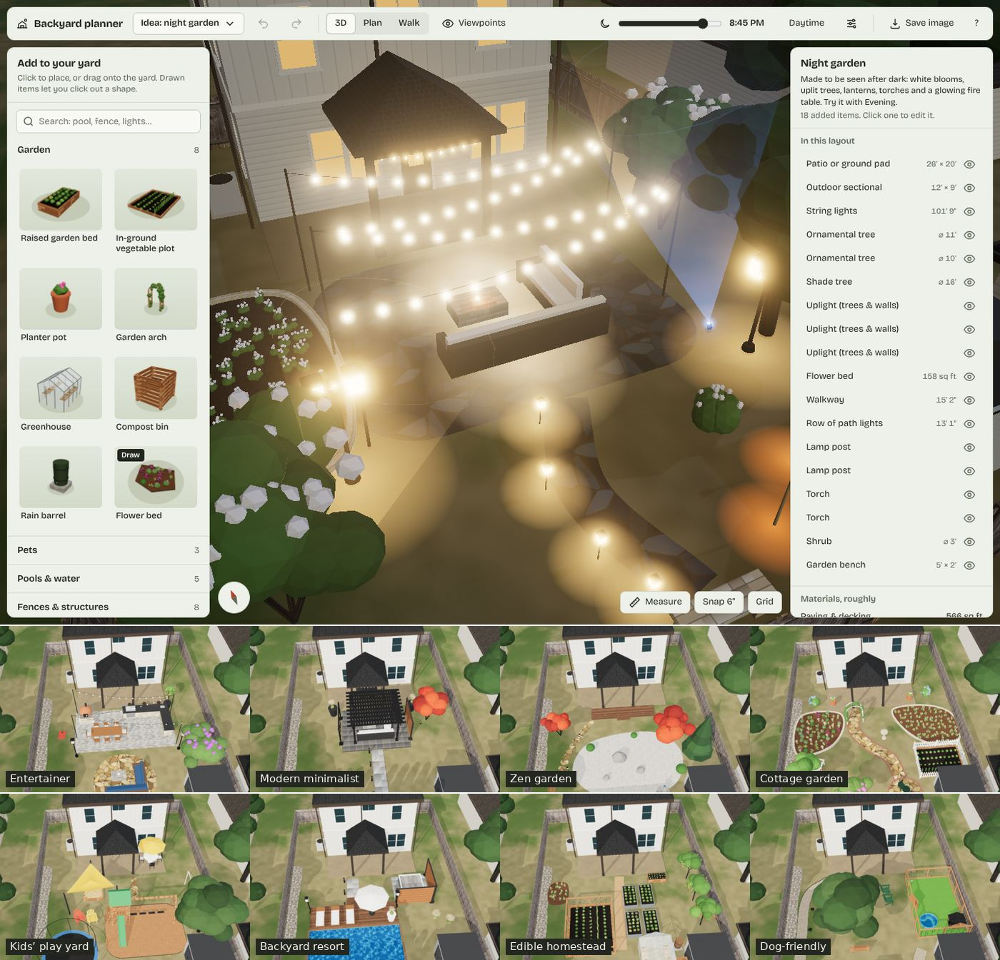

# Backyard Planner

A 3D designer for one real backyard: a two-story house with a 29 × 10 ft concrete patio, a covered patio roof, a resin shed and a weathered wood privacy fence. Try out gardens, a puppy run, pools, privacy fencing, fire pits, walkways, landscaping, lighting and a grilling area, and move or resize any of it. Open `index.html` in a recent browser with WebGL. There is nothing to install, and it works offline.

## What it does

- **Start from the real yard.** I measured the house, patio, patio roof, shed, fence lines and river rock drainage strip from photos of the yard and checked them against the known size of the patio. The fence uses a texture taken from one of those photos. These existing pieces are locked, and you can unlock any of them to adjust it.
- **Add things.** There are 66 kinds of items in 10 groups: garden, pets, pools and water, fences and structures, fire and grilling, seating, plants and trees, paths and surfaces, lighting, and play. Click an item to place it, or drag it onto the yard.
- **Move, resize and rotate.** Drag an item to move it. Drag the gold handles to resize it, and the white ring to rotate it. You can also type sizes in feet and inches. Each item has its own options, such as fence style, pool wall, paver pattern, bloom color or chair count.
- **Draw shapes.** Walkways, fence lines, hedges, string lights, rows of path lights, dry creek beds, flower beds and custom surfaces are drawn point by point and reshaped afterward.
- **See how far things are.** The inspector shows how far the selected item is from the house and from each fence. A measuring tool works anywhere in the yard.
- **Get rough material amounts.** Each layout totals its paving, gravel and mulch (with cubic yards at 3 in. deep), new fencing and string light length.
- **Compare layouts.** Save, duplicate, rename and switch between layouts. Export and import them as JSON.
- **Start from an example.** It comes with 15 example layouts, each built around a different design approach:

  | Layout | Approach |
  |---|---|
  | Pool, pup and fire pit | Round pool, fire pit circle and a fenced puppy run |
  | Garden retreat | Raised beds and a rose arch, plus a steel pergola lounge |
  | Hill Country xeriscape | Native Texas plants, limestone and decomposed granite |
  | Modern minimalist | Charcoal slabs, black steel, white gravel and a cypress wall |
  | Zen garden | Raked gravel, stone, a low deck and a few chosen trees |
  | Cottage garden | Dense flowers, a curving path and a picket-fenced vegetable patch |
  | Kids' play yard | Swing set, trampoline and shaded sandbox in view of the patio |
  | Entertainer's yard | L-shaped kitchen, dining for eight, fire-table lounge and cornhole |
  | Backyard resort | Rectangular pool with a raised sun deck and a screened hot tub |
  | Edible homestead | Beds, an orchard row, a greenhouse and compost |
  | Dog-friendly yard | A big turf run, splash pool and a pea gravel sniffing loop |
  | Simple and budget-friendly | Gravel, a steel fire bowl, a stock tank pool and string lights |
  | Mediterranean courtyard | Brick, a central fountain, potted citrus and a vine pergola |
  | Pollinator garden | Flowers, grasses and water for birds and butterflies |
  | Night garden | White blooms, uplit trees, lanterns and torches, made for after dark |

- **Sun and night.** Set the time of day and the month to see where shade falls. After sunset, the fixtures you've added light up the yard.
- **Three ways to look.** Orbit in 3D, switch to a top-down plan, or walk around at eye level.

## Controls

| Input | Action |
|---|---|
| Drag empty ground, right-drag, scroll | Orbit, pan, zoom |
| Click, drag | Select an item, move it |
| R, Shift+R | Rotate 15° right or left |
| Arrow keys (Shift for 2 ft) | Nudge 6 in. |
| Ctrl+D, Delete | Duplicate, remove |
| Ctrl+Z, Ctrl+Shift+Z | Undo, redo |
| Enter, Backspace, Esc | Finish, remove the last point, or cancel while drawing |
| Alt while dragging | Turn off grid snapping |
| 1 / 2 / 3 | 3D, plan, walk |
| W A S D, drag | Move and look in walk mode |
| M, G, F | Measure, grid, zoom to the selected item |

Left and right mean as seen standing on the patio looking out.

## Notes

- Layouts are saved in your own browser (localStorage). Nothing is sent anywhere. Use Export to back them up or move them to another computer.
- The yard dimensions other than the patio are estimates from photos. Set "Yard faces" in the settings to the real compass direction so the shade is right; it defaults to south.
- The original yard photos are left out of this copy. The fence texture, cropped from one of them, is the only image from the yard that's included.
- Everything is built in code except that fence texture: models, the lawn, paving and other textures, and the sky. three.js, esbuild and the two fonts (Bricolage Grotesque and Architects Daughter) are bundled into the page.
- To rebuild `index.html` after editing the code: `cd source && npm install && npm run build`. The build reads the fence texture from the current `index.html`.
