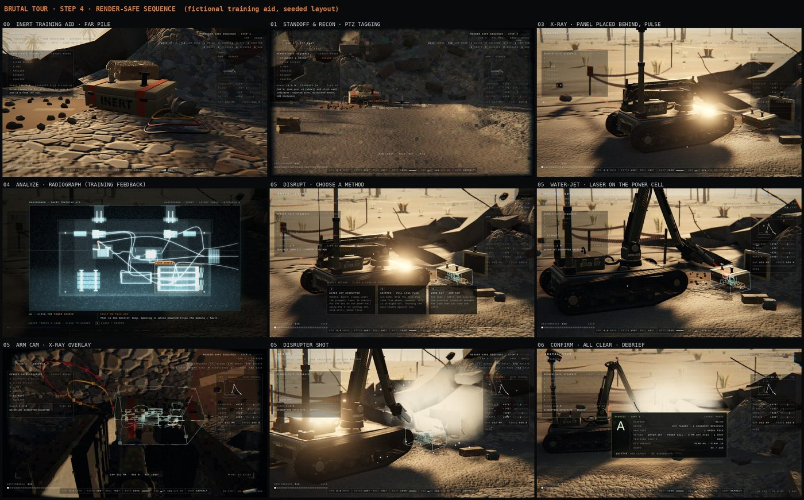

# Brutal Tour

A browser game where you remotely drive a tracked EOD robot down a training lane and render an **inert training aid** safe. The setting is an Iraq War training lane outside a fictional FOB near Baghdad in 2007. Open `index.html` in a recent desktop browser with WebGL2. There is nothing to install.

## What it does

- **Drive the robot.** Tank-style tracks, with traction, pitch and roll on the terrain. The robot can tip over, and it leaves ruts, track marks and dust. The video link lags and drops out as signal strength falls.
- **Work the arm.** Shoulder, elbow, wrist and wrist-rotate joints, plus an optional mode where the mouse moves the gripper. Pick up, carry and drop rubble and bricks, which tumble when dropped. A disturbance meter rises when you bump things or move debris roughly.
- **Render the aid safe.** The run goes through six stages:
  1. **Standoff and recon:** tag three indicators through the PTZ camera.
  2. **Clear access:** lift the covering rubble off with the gripper.
  3. **X-ray:** place an X-ray panel behind the aid and fire it.
  4. **Analyze:** trace the circuit on the radiograph to find the power source and the safe link. Wrong answers explain why instead of failing you.
  5. **Disrupt:** water-jet disrupter, pulling the link plug, or cutting one wire on the gripper camera.
  6. **Confirm:** inspect the result, then get ALL CLEAR and a graded debrief.
- **Replay it.** The internal layout is generated from a seed, so every run can be different.

## Controls

| Key | Action |
|---|---|
| W A S D | Drive |
| 1 / 2 / 3 / 4 | Drive cam / gripper cam / PTZ mast cam / spotter view |
| Mouse drag and wheel | Pan and zoom the PTZ camera or the spotter view; click to tag in recon |
| 0, F | Orbit view, flyover |
| R, Shift+R | Recover after a rollover; restart with a new layout |
| H | Hide or show the HUD |
| Tab | Arm mode (only when the robot is stopped) |
| W/S, ↑/↓, Z/X, A/D | Shoulder, elbow, wrist, wrist rotate (in arm mode) |
| Q / E | Open or close the gripper |
| Shift, P, I | Fine control, ready/stow pose, mouse-driven (IK) gripper mode |
| Space | Fire the X-ray, or fire the disrupter |
| V, Esc | Open or close the radiograph |
| J / G / K | Choose water-jet, pull plug, or wire cut |
| O | Toggle the X-ray outline drawn over the aid |
| N | Put the X-ray panel back on the robot's deck |

URL options: `?start=pile` starts at the standoff position, and `?seed=1a2b` (hex) replays a specific layout.

## Notes

- Everything is generated in code: geometry, textures and sound. The only download is three.js, which loads from the jsDelivr CDN, so the page needs an internet connection.
- The training aid's internals are made up for the game (a power cell, a "trigger module", a relay and decoys). They don't model how any real device is built.
- No civilians, no casualties, no gore.
